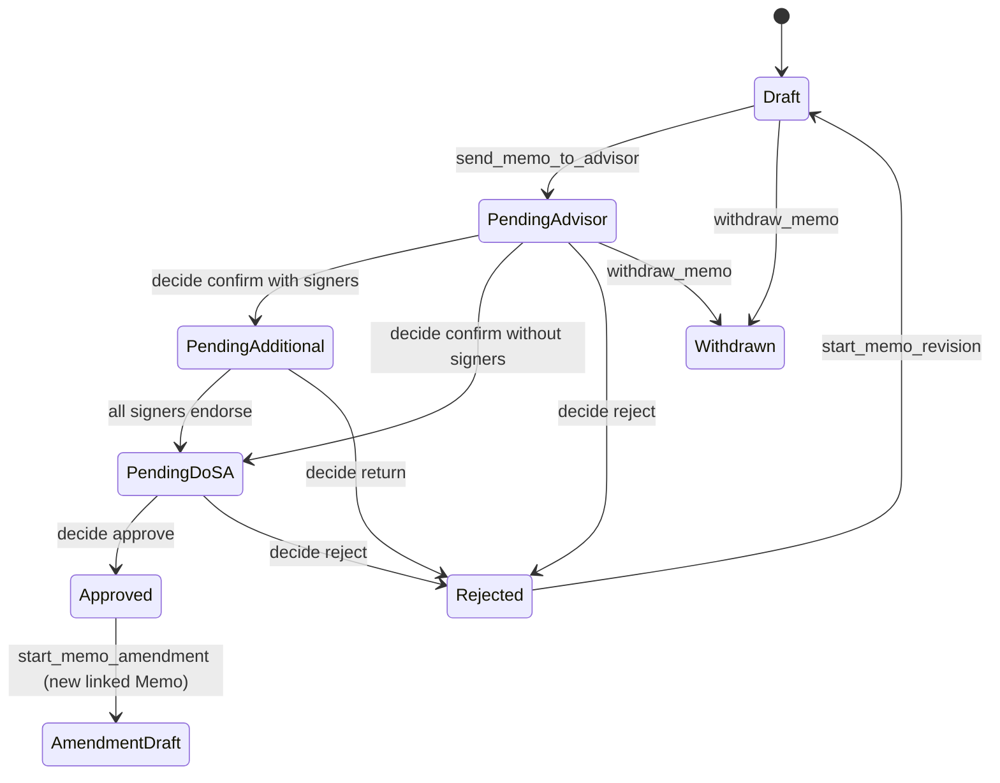

# Amader TOWNHALL - Implementation context and handover

This is the entry point for any person or model continuing the build. Read it before touching code, and update it in the same change as the code (traceability table, decisions log, next steps).

Last updated: Increments 3-6 have a first working slice (booking, finance totals, internal notices, handover, term counts). Next: deepen each slice (race on two confirmations, OCR file evidence, external publishing, historical import).

---

## 0. Reading order and precedence

| Order | Document | Owns |
|---|---|---|
| 1 | this file | Current state, module map, conventions, traceability, decisions, next steps |
| 2 | [`AGENTS.md`](../AGENTS.md) | Coding practice: test-first, commands, scoping, tests, migrations, evidence |
| 3 | [`GRAND_PRD.md`](../GRAND_PRD.md) | Product behavior. FR/UC/AC/BR/NFR identifiers. Section 2.6 holds the Programming Club operating rules |
| 4 | [`TECHNICAL_REQUIREMENTS.md`](../TECHNICAL_REQUIREMENTS.md) | Architecture, HTTP contracts, data invariants, transactions, integrations, release gates |
| 5 | [`docs/SDS.pdf`](SDS.pdf) | MVC map, use-case and DFD diagrams, state diagrams, screen design (page 12) |
| 6 | [`ASSESSMENT.md`](../ASSESSMENT.md) | Evidence actually collected (tests run, coverage, heuristics, docstrings) |

If documents disagree: the PRD wins on behavior, the technical requirements win on architecture and verification, and AGENTS.md wins on coding practice. Record any interpretation in section 9 (decisions log); never edit the PRD text silently (AGENTS.md section 6).

The PRD is about 3,400 lines. Use the line ranges in section 12 to read only what the next increment needs.

---

## 1. Current state at a glance

| Item | State |
|---|---|
| Stack | Python 3.13, Django 6.1 (server-rendered templates), FastAPI 0.165 (private assistance), PostgreSQL 17, psycopg 3, uv |
| Increment 1 (access and club setup) | Done: AC-15, AC-17 pass |
| Increment 2 (first event and memo) | Done: AC-01, AC-13, AC-16 pass; memo parts of AC-18 and deadline parts of AC-19 pass |
| Increments 3-6 | Local paths are in place: booking including a move, finance forms, unverified receipt reading, internal notices, external send that fails until a site is set, CSV import, handover, and term counts. Live venue figures, a real website, and a real receipt reader are not connected |
| Tests | 129 passing on 22 Nov 2026 after the finance forms, booking move, receipt reading, external notice, and CSV import: unit, integration, PostgreSQL race, FastAPI contract, Playwright browser, acceptance. One pytest-playwright fixture warning |
| Coverage | Full suite 82% of `apps`, `assistance` and `config`. Unit and contract layers alone: 25% (reported separately) |
| Lint and format | Ruff clean. `manage.py check` clean. `check --deploy` clean with production settings |
| Docstrings | 100% of public command members (`interrogate`) |
| CI | `.github/workflows/ci.yml` runs the AGENTS.md gate on a PostgreSQL 17 service. It has not yet run on GitHub because nothing has been pushed |

---

## 2. Product in one page

**Purpose.** One record follows an IUB club event from its memo draft through Faculty Advisor confirmation, DoSA Head approval, venue confirmation, publication, expenses and EB handover. Reviewers can always answer three questions: who acts next, which version was approved, and which evidence supports a figure (PRD 1.1).

**Actors (PRD 2.1).** These are the values of `apps/platform_core/access.py:AccessCategory`:
- **System Admin.** Bootstraps the first Head and manages accounts. Never signs memos.
- **DoSA Head.** The single DoSA persona. Makes the final memo decision. Clubs, settings, templates.
- **Designated signer.** For example a Department Head. Acts only on signature tasks assigned to their own identity.
- **Club EB member.** Acts through one shared EB interface. President, Secretary and Treasurer are typed designations that grant nothing.
- **Faculty Advisor.** Confirms or rejects the club's memo, names extra signers, and endorses budget requests.

**Memo journey (PRD 2.2.2, 2.6).**
1. The EB types the memo manually. Nothing is prefilled.
2. Sending freezes a version for the assigned Advisor.
3. The Advisor e-signs and confirms, or rejects with a reason, and may name extra signers.
4. Each extra signer endorses or returns.
5. The Head e-signs and approves, or rejects.
6. A rejection reopens a linked revision that needs fresh signatures.
7. A late submission is flagged, never blocked. The lead time is 7 calendar days, or 1 calendar month for an event designated Big, clamped at month end.

**Venue (PRD 2.6, Increment 3).** The booking form comes after event permission.
- **Evening classroom (6 to 9 p.m.):** needs Advisor and Department Head permission, then DoSA confirmation.
- **Full-day Friday or Saturday classroom:** needs both a DoSA and an Admin form approval.
- **DMK, MPH or Auditorium:** at least 350 expected students, within the venue's actual capacity.
- **Two-day events:** reserve both days atomically or neither.

**Finance (PRD 3.1.2, Increment 4).** Allocations, scheduled releases and confirmed releases are distinct figures. Only verified expenses reduce the balance. Corrections are linked adjustments. Currencies are never mixed without a conversion record.

---

## 3. Repository map and MVC responsibility (SDS page 2)

| Path | Responsibility |
|---|---|
| `config/settings/{base,dev,test,prod}.py` | Settings. Asia/Dhaka, BDT, `MAILERS` (Django 6.1), secure cookies. Production rejects `DEMO_AUTH` |
| `config/urls.py` | Root URLs. `/` is the role dashboard |
| `apps/platform_core/` | Shared platform: `clock`, `access` (engine), `protocol` (command protocol), `audit`, `jobs` (durable jobs and worker), `notifications`, `files` (private storage), `policy`, `exceptions`, `middleware`, `checks`, health, downloads, deliveries, workflow settings |
| `apps/accounts/` | `Profile` (the `AUTH_USER_MODEL`), `Grant`, `ProfileChangeRequest`; OpenID Connect sign-in (`oidc.py`), demo login, dashboard composition (`dashboard.py`), provisioning, `bootstrap_admin` and `seed_demo` commands |
| `apps/clubs/` | `Club`, `Term`, `Assignment` (EB appointment or Advisor link, dated), `ArchiveCorrection` |
| `apps/events/` | `Event` (working draft) and `EventVersion` (immutable snapshot) |
| `apps/finance/` | `Budget`, `BudgetVersion`, `BudgetLine`, `BudgetRequestReview` |
| `apps/memos/` | `MemoTemplate`, `TemplateVersion`, `Memo`, `MemoVersion`, `MemoAttachment`, `SignatureTask`, `Signature`, `MemoDecision`; `export.py` (A4 and PDF), `access.py` (file and export rules) |
| `apps/publishing/`, `apps/analytics/` | Empty app shells for Increments 5 and 6 |
| `assistance/` | FastAPI `app.py`, Pydantic `contracts.py`, `client.py` (Django-side with fallbacks), `providers/fake.py` |
| `templates/`, `apps/*/templates/` | Accessible templates. `includes/form.html` renders an error summary, `aria-invalid` and `aria-describedby` |
| `static/css/app.css`, `static/js/app.js`, `static/js/signature.js` | Plain CSS. JavaScript only for confirmation dialogs, focus management and the signature canvas |
| `tests/` | `unit`, `integration`, `race`, `contract`, `browser`, `acceptance`; plus `factories.py` and `memo_helpers.py` |
| `tools/check_req_markers.py` | Reconciles `@pytest.mark.req` IDs with the PRD (run in CI) |

**Per-app module pattern (AGENTS.md section 2).**
- `models.py`: records, TextChoices statuses, database constraints.
- `commands.py`: typed write commands named after the user action.
- `selectors.py`: scoped reads that raise `NotFoundError` for out-of-scope records.
- `views.py`: parse the request, identify the actor, call the command, render.
- `forms.py`: parsing and display only.
- `dashboard.py`: the app's role-dashboard section.

### 3.1 Command list (all in `apps/*/commands.py`)

| App | Commands |
|---|---|
| accounts | `bootstrap_admin`, `provision_profile`, `set_grants`, `set_profile_active`, `resend_invitation`, `request_profile_change`, `decide_profile_change`, `sign_in_with_identity` |
| clubs | `register_club`, `update_club_identity`, `archive_club`, `update_internal_profile`, `create_term`, `activate_term`, `close_term`, `appoint_member`, `assign_advisor`, `end_assignment`, `correct_archive_record` |
| events | `create_event`, `save_event_draft`, `snapshot_event` (internal helper) |
| finance | `save_budget_version`, `review_budget_request` |
| memos | `create_template`, `revise_template`, `set_template_active`, `create_memo`, `save_memo_draft`, `upload_memo_attachment`, `send_memo_to_advisor`, `decide_memo` (confirm, endorse, approve, reject, return), `assign_additional_signers` (called by `decide_memo`), `start_memo_revision`, `withdraw_memo`, `start_memo_amendment`, `change_approval_deadline` |
| platform_core | `save_policy_version`, `jobs.retry_job` |

---

## 4. Conventions every change must follow

1. **Command protocol** (`apps/platform_core/protocol.py`, TR section 5). Wrap every write in `execute(actor=..., action=..., operation_key=..., payload=..., handler=...)`.
   - It runs one atomic transaction and claims `(actor, action, key)` in `CommandReceipt` inside a savepoint.
   - A replay with the same payload returns the stored `CommandResult(replayed=True)`.
   - The same key with a different payload raises `OperationKeyConflict` (409).
   - A domain error rolls back the receipt too, so the operation can be retried.
   - Forms carry the key as a hidden field (`CommandForm`); JSON clients send `operation_key`.
2. **Access** (`apps/platform_core/access.py`). An action is allowed only when all of these hold:
   - the profile is active;
   - the action is inside the category `CEILING`;
   - there is an unrevoked `Grant` (a System Admin implicitly holds its whole ceiling);
   - for `CLUB_SCOPED` actions, an assignment is effective today (inclusive dates) and, for EB members, its term is `active`.

   The Head and Admin have global scope. Use `can`, `require`, `club_ids_in_scope` and `is_assigned_advisor`. Recheck inside the command transaction. An out-of-scope record raises `NotFoundError` (404, concealed); a forbidden action on a visible record raises `PermissionDeniedError` (403).
3. **Locks.** Use `select_for_update(of=("self",))` whenever the query also uses `select_related` on a nullable foreign key. PostgreSQL rejects `FOR UPDATE` across a nullable outer join, and the tests caught this. Documented lock orders:
   - memos: Memo, then MemoVersion, then SignatureTask;
   - clubs: Club, then Term, then Assignment;
   - finance: Budget, then BudgetVersion.

   Increment 3 must lock Venue rows, in stable ID order for a move (TR section 5).
4. **Audit** (`apps/platform_core/audit.record`). Call it inside the transaction for every material action. The `AuditEntry` table has a PostgreSQL trigger that rejects UPDATE and DELETE (migration `platform_core/0002`).
5. **Side effects.** Use `notifications.notify(...)` inside the transaction. It creates one `Notification` per (event_key, recipient) and, for email, one `Job` with `dedupe_key`.
   - The worker (`python manage.py run_worker`) leases jobs with `SKIP LOCKED`, runs handlers outside locks, retries with backoff, and marks a job `failed` or `uncertain` for operator retry on `/deliveries/`.
   - Never send email or call providers inside a command.
6. **Revisions.**
   - Mutable drafts carry `revision`. Commands take `expected_revision` and raise `StaleRevisionError`, which carries `current_state`.
   - Immutable records are never updated in place: `TemplateVersion`, `MemoVersion` content, `Signature`, `MemoDecision`, `BudgetVersion` and its lines, `EventVersion`. Use a new version, a revision or an adjustment instead.
7. **Files** (`apps/platform_core/files.py`).
   - Content type is detected from the leading bytes (PDF, PNG, JPEG). Size is limited, a SHA-256 digest is stored, and files are written under a generated key in `PRIVATE_MEDIA_ROOT`.
   - Downloads go through `/files/<uuid>/` and `/exports/<id>/`, which call the access rule registered for the owner type (`register_file_access`, `register_export_access`).
   - An owner type without a registered rule is never served.
8. **Time and money.**
   - Use `platform_core.clock.now()`, `local_today()` and `combine_local()`. Never call `datetime.now()` directly.
   - Store instants in UTC and display them in Asia/Dhaka (template filter `local_dt`).
   - Money is `Decimal` in `DecimalField(14,2)` with an explicit currency, defaulting to BDT.
9. **Policy** (`apps/platform_core/policy.py`). `effective_policy(date)` returns the version in force. A memo version stores `policy_version`. Missing institutional values are synthetic and labelled (`is_synthetic=True`); see section 10.
10. **Errors at the boundary.**
    - `DomainError` subclasses map to 403, 404, 409 and 422 through `DomainErrorMiddleware`, with a JSON envelope `{error:{code,message,field_errors,request_id}}` for JSON clients.
    - Forms use `apply_domain_error(form, exc)`.
    - Unauthenticated browsers are redirected to `/auth/sign-in/`. Unauthenticated JSON clients get 401.
11. **Tests.**
    - Name each test after its outcome and add `@pytest.mark.req("FR-..","AC-..")`. Use arrange, act and assert, the `frozen_clock` fixture (1 Dec 2026, 10:00 Dhaka), and the `world` fixture (two synthetic clubs).
    - Race tests use `django_db(transaction=True)` and the `race()` helper in `tests/race/test_memo_races.py`, which uses a `threading.Barrier` and independent connections.
    - Transactional tests truncate tables, so request the `initial_policy` fixture.

---

## 5. Data model summary and invariants

| Record | Key invariants (database or command) |
|---|---|
| `accounts.Profile` | Email unique, also case-insensitively (`Lower` index); unique `(oidc_issuer, oidc_subject)` when bound; unusable password; at most one active DoSA Head (command check); `revision` |
| `accounts.Grant` | One unrevoked grant per (profile, action) (partial unique); revocation keeps the row |
| `accounts.ProfileChangeRequest` | Route `ordinary` (DoSA) or `protected` (account admin); applied once; stores original and proposed values |
| `clubs.Club` | Stable ID; unique name and short code; archived clubs start nothing new |
| `clubs.Term` | `end >= start`; one `active` term per club (partial unique); overlap allowed only with `transition_approved` |
| `clubs.Assignment` | EB kind requires a term; `end >= start`; one holder per single-holder designation (`SINGLE_HOLDER_DESIGNATIONS`) checked under the club lock; `revision` for archive corrections |
| `events.Event` / `EventVersion` | `last_date >= first_date`, `end_time > start_time`; versions unique per event; `memo_approved_version` records the memo-approved snapshot |
| `finance.BudgetVersion` / `BudgetLine` | Number unique per budget; requested amount > 0; line amount >= 0; quantity > 0; at most one review per version |
| `memos.TemplateVersion` | Immutable; activation requires `advisor` and `dosa` signature areas |
| `memos.MemoVersion` | Number unique per memo; frozen `snapshot` and `content_sha256`; separate `submitted_at`, `dosa_queue_entered_at`, `approval_deadline`, `event_starts_at`, `submission_target`, `is_late` (BR-03) |
| `memos.MemoDecision` | One final decision per (version, stage) for the Advisor and DoSA stages; one per (version, stage, actor); reject or return requires a reason (check constraint) |
| `memos.Signature` | One per (version, stage, signer); stores the image digest and the signed `content_sha256` |
| `platform_core.*` | `AuditEntry` append-only (trigger); `CommandReceipt` unique (actor, action, key); `Job.dedupe_key` unique; `Notification` unique (event_key, recipient); `PolicyVersion` lead times bounded; `btree_gist` extension installed for Increment 3 |

---

## 6. State machines

| Machine | States (PRD 3 "Workflow states") | Status |
|---|---|---|
| Memo | Draft, Pending Advisor Confirmation, Pending Additional Signatures, Pending DoSA Approval, Approved, Rejected, Withdrawn | **Implemented** (`MemoStatus`, `decide_memo`, `withdraw_memo`, `start_memo_revision`, `start_memo_amendment`) |
| Event | Draft, Awaiting Approvals, Approved, Completed, Cancelled | **Partial**: Draft becomes Awaiting Approvals on memo send, and returns to Draft when the original memo is withdrawn. Approved needs the memo and, where applicable, venue confirmation (Increment 3) |
| Venue booking | Pending, Confirmed, Returned for Correction, Declined, Cancelled, plus a linked replacement | Not started (Increment 3) |
| Expense | Draft, Submitted, Verified, Returned, Rejected, plus linked adjustment | Not started (Increment 4) |
| Fund release | Scheduled, Released or Cancelled, plus linked adjustment | Not started (Increment 4) |
| Publication | Unpublished, Publishing, Published, Failed or Uncertain, Withdrawn (per destination) | Not started (Increment 5) |

Memo transitions as built:



---

## 7. Business rules: where they are enforced

| Rule | Enforcement |
|---|---|
| BR-01 club identity and scope | `Club` foreign keys on records; `access.club_ids_in_scope`; selectors raise `NotFoundError`; tests `test_eb_member_acts_only_in_the_assigned_club`, AC-11 parts |
| BR-02 signature binds to an immutable version | `Signature.version`, `content_sha256`; revision creates a new `MemoVersion`; `test_revision_after_rejection_needs_fresh_signatures` |
| BR-03 separate dates | `MemoVersion` fields; `test_send_freezes_version_records_dates...` |
| BR-04 exclusive reservation only on confirmation | Increment 3 (GiST exclusion constraint) |
| BR-05 allocated, scheduled and confirmed figures are distinct | Requested amount kept separate from finance records; allocations and releases arrive in Increment 4 |
| BR-06 verified figures vs OCR | Increment 4. OCR contract labels output `unverified` |
| BR-07 cancellation and archive preserve history | `archive_club` keeps records; `PROTECT` foreign keys everywhere; event cancellation in Increment 3 |
| BR-08 material changes trigger checks | Memo amendments flow through all stages; event and booking effects in Increment 3 |
| BR-09 AI and OCR cannot change state | FastAPI has no database access; provider output filtered to request IDs; contract tests |
| BR-10 no duplicate official records | `CommandReceipt`, unique decision constraints, `Notification` and `Job` dedupe; race tests |
| BR-11 event cash flow uses only attributed amounts | Increment 4 |
| BR-12 server state is authoritative | `StaleRevisionError` with `current_state`; the review screen re-reads the state |

---

## 8. Traceability (update the Status column as you build)

Status: **Done** means all Success and Failure outcomes are implemented with tests. **Partial** means some outcomes are in place (the notes say which). **Not started**. Run `uv run python tools/check_req_markers.py --markdown` for the authoritative list of IDs and tests.

### 8.1 Functional requirements (91)

| FR | Title | Status | Module / tests |
|---|---|---|---|
| FR-IAM-01 | Sign in with IUB Google | Done (live client pending, PRD C.2) | `accounts/oidc.py`, `sign_in_with_identity`; `test_accounts.py`, AC-15 |
| FR-IAM-02 | Persona, scope, privileges | Done | `access.py`, `set_grants`; `test_accounts.py`, `test_provisioning.py` |
| FR-IAM-03 | Create, activate, deactivate profiles | Done | `provision_profile`, `set_profile_active`, `bootstrap_admin`; `test_provisioning.py` |
| FR-IAM-04 | Access linked to term or Advisor assignment | Done | `Assignment`, `active_assignment_filter`; `test_accounts.py`, `test_clubs.py` |
| FR-IAM-05 | View profile, request changes | Done | `request_profile_change`, `decide_profile_change`; `test_accounts.py`, AC-17 |
| FR-IAM-06 | Role dashboard | Done | `accounts/dashboard.py` and `apps/*/dashboard.py`; `test_accounts.py`, `test_page_smoke.py` |
| FR-IAM-07 | Authorize and record admin actions | Done | Commands plus `audit.record` |
| FR-IAM-08 | Administrative settings | Partial: lead times, approval buffer, review window, working days, notification preference. Venue restrictions arrive in Increment 3 | `save_policy_version`; `test_platform_core.py` |
| FR-CLB-01 | Official club register | Done | `register_club`, `update_club_identity`, `archive_club` |
| FR-CLB-02 | Create and close EB terms | Done | `create_term`, `activate_term`, `close_term` |
| FR-CLB-03 | Appoint EB members | Done | `appoint_member` |
| FR-CLB-04 | Club organogram | Done | `club_detail` view (`?term=`) |
| FR-CLB-05 | EB archive browse and correct | Done | `archive` view, `correct_archive_record` |
| FR-CLB-06 | Leadership handover | Not started (Increment 6) | |
| FR-CLB-07 | Internal club profile | Done | `update_internal_profile` |
| FR-FIN-01 | Allocations by period | Not started (Increment 4) | |
| FR-FIN-02 | Schedule and confirm releases | Not started (Increment 4) | |
| FR-FIN-03 | Club funding and balance | Not started (Increment 4) | |
| FR-FIN-04 | Event budget and requested amount | Done | `save_budget_version`, `review_budget_request`; `test_events_budget.py` |
| FR-FIN-05 | Planned vs verified spending | Not started (Increment 4) | |
| FR-FIN-06 | Create and submit expense | Not started (Increment 4) | |
| FR-FIN-07 | Attach and inspect original bills | Not started (Increment 4); file platform ready | |
| FR-FIN-08 | OCR extraction | Not started; FastAPI contract `/internal/v1/ocr/extract` ready | `assistance/` |
| FR-FIN-09 | Duplicate or inconsistent bill flags | Not started (Increment 4) | |
| FR-FIN-10 | Verify, return, reject expense | Not started (Increment 4) | |
| FR-FIN-11 | Event cash flow ledger | Not started (Increment 4) | |
| FR-FIN-12 | Export financial records | Not started (Increment 4) | |
| FR-FIN-13 | Financial corrections | Not started (Increment 4) | |
| FR-MEM-01 | Memo templates | Done | `create_template`, `revise_template`, `set_template_active`; AC-13 |
| FR-MEM-02 | Author and save draft | Done | `create_memo`, `save_memo_draft` |
| FR-MEM-03 | Complete memo information | Done | `submission_problems`, `upload_memo_attachment` |
| FR-MEM-04 | E-signature on a version | Done (drawn or typed) | `_record_signature`; browser journey |
| FR-MEM-05 | Stage validation | Done | `send_memo_to_advisor`, `decide_memo` |
| FR-MEM-06 | Send and record submission | Done | `send_memo_to_advisor`; race test |
| FR-MEM-07 | Three-stage routing | Done | `decide_memo`, `assign_additional_signers` |
| FR-MEM-08 | Approve or reject | Done | `decide_memo`; AC-01, AC-16, race test |
| FR-MEM-09 | Revise and resubmit | Done | `start_memo_revision` |
| FR-MEM-10 | Pending work and progress | Done | `memo_list`, `memo_detail`, `selectors.next_actor` |
| FR-MEM-11 | Submission, deadline, event dates | Done | `policy.submission_target`, `change_approval_deadline`; `test_deadline_policy.py` |
| FR-MEM-12 | Amendment after approval | Partial: linked amendment memo through all stages, original stays authoritative. Applying approved event, venue and notice changes needs Increments 3 and 5 | `start_memo_amendment` |
| FR-MEM-13 | Withdraw or export | Done | `withdraw_memo`, `memos/export.py` |
| FR-EVT-01 | Create event record | Done | `create_event` |
| FR-EVT-02 | Change event details | Partial: draft edits with stale protection. Approved-event amendment proposals arrive in Increment 3 | `save_event_draft` |
| FR-EVT-03 .. FR-EVT-11 | Venues, availability, booking, overlap, confirmation, decide, reschedule, calendar, blocks | Not started (Increment 3) | |
| FR-EVT-12 | Separate event, memo and booking statuses | Partial: the event page shows separate statuses; booking arrives in Increment 3 | `events/event_detail.html` |
| FR-EVT-13 | Restricted hours in Dhaka time | Not started (Increment 3) | |
| FR-EVT-14 | Complete or cancel event | Not started (Increment 3) | |
| FR-AIS-01 .. FR-AIS-06 | AI scheduling | Not started; contract, fake provider, client fallback and contract tests ready | `assistance/` |
| FR-AIP-01 | Separate dates for priority | Partial: separate fields stored; queue uses them | `MemoVersion`, `selectors.dosa_queue` |
| FR-AIP-02 | Prioritize actionable requests | Partial: deterministic order (deadline, event start, queue entry, memo ID); AI ranking and overrides arrive in Increment 5 | `dosa_queue`; contract tests |
| FR-AIP-03 | Explain priority | Partial: explanations exist in the priority contract and fallback only | `providers/fake.deadline_order` |
| FR-AIP-04 | Overdue vs insufficient time | Partial: queue shows overdue, late and missing-deadline labels | `memo_list.html`, `memos/dashboard.py` |
| FR-AIP-05 | Filter and adjust queue order | Not started (Increment 5) | |
| FR-AIP-06 | Deadline-order fallback | Partial: `prioritize_with_fallback` and the base queue order | `assistance/client.py` |
| FR-PUB-01 .. FR-PUB-07 | Publishing | Not started (Increment 5) | |
| FR-ANL-01 .. FR-ANL-09 | Analytics | Not started (Increment 6) | |
| FR-COM-01 | Scoped search | Partial: filters on memos, events, accounts and archive; no cross-record search yet | |
| FR-COM-02 | Notices and delivery outcomes | Done | `notifications.py`, `jobs.py`, `/deliveries/` |
| FR-COM-03 | Record material actions | Done | `audit.py` plus trigger |
| FR-COM-04 | Save related changes together | Done | `protocol.execute`; race tests |
| FR-COM-05 | Versions and links | Done for memos, budgets and events | Version models |
| FR-COM-06 | Validate and protect uploads | Done | `files.py`; `test_platform_core.py` |
| FR-COM-07 | Historical records with source | Not started (Increment 6) | |
| FR-COM-08 | Errors and recoverable drafts | Done | `includes/form.html`, stale warnings, `CommandForm` |

### 8.2 Use cases (47)

| UC | Status | | UC | Status |
|---|---|---|---|---|
| UC-01 Sign in | Done | | UC-25 Amendment | Partial (memo flow) |
| UC-02 Provision | Done | | UC-26 Withdraw or export | Done |
| UC-03 Profile corrections | Done | | UC-27 Event changes | Partial (create and draft) |
| UC-04 Dashboard and notifications | Done | | UC-28 to UC-34 Venues and events | Not started |
| UC-05 Workflow rules | Partial (no venue rules) | | UC-35 AI scheduling | Not started (contract ready) |
| UC-06 Club register and profile | Done | | UC-36 Priority queue | Partial (base order) |
| UC-07 Terms, appointments, handover | Partial (handover in Increment 6) | | UC-37 to UC-39 Publishing | Not started |
| UC-08 Organogram and archive | Done | | UC-40 to UC-44 Analytics | Not started |
| UC-09, UC-10 Allocations and overview | Not started | | UC-45 Search | Partial |
| UC-11 Event budget | Done | | UC-46 History | Partial (audit tables on club, profile and memo pages) |
| UC-12 to UC-17 Finance | Not started | | UC-47 Historical import | Not started |
| UC-18 to UC-24 Memos | Done | | | |

### 8.3 Acceptance scenarios (20)

| AC | Status | Evidence |
|---|---|---|
| AC-01 Digital memo and resubmission | **Pass** | `tests/acceptance/test_ac01_memo_resubmission.py`, `tests/browser/test_memo_journey.py` |
| AC-02 Concurrent venue requests | Not started | Increment 3 |
| AC-03 Separate finance states | Partial: requested amount endorsed without allocation or release | `test_events_budget.py` |
| AC-04 Bill OCR and correction | Not started | Increment 4 |
| AC-05 AI scheduling fallback | Partial: contract fallback only | `tests/contract/` |
| AC-06 Priority and deadline change | Partial: deadline change traceable, base order | `test_memos.py`, `tests/contract/` |
| AC-07 Publish and reschedule | Not started | Increment 5 |
| AC-08 Cancellation with preserved history | Not started | Increment 3 or 6 |
| AC-09 EB handover and legacy | Partial: term close ends access | `test_clubs.py` |
| AC-10 DoSA event review | Not started | Increment 6 |
| AC-11 Cross-club authorization | Partial: memo, event, budget, export, club denial | `test_memos.py`, `test_accounts.py`, AC-17 |
| AC-12 Corrections and auditability | Not started | Increment 4 |
| AC-13 Memo template versioning | **Pass** | `tests/acceptance/test_ac13_template_versioning.py` |
| AC-14 Restricted hours and AI slot validation | Not started | Increments 3 and 5 |
| AC-15 Account access and role dashboard | **Pass** | `tests/acceptance/test_ac15_account_access.py` |
| AC-16 Advisor rejection and conflicting decisions | **Pass** | `tests/acceptance/test_ac16_advisor_rejection.py`, `tests/race/test_memo_races.py` |
| AC-17 Permission and profile changes | **Pass** | `tests/acceptance/test_ac17_permission_changes.py` |
| AC-18 Interrupted actions and retries | Partial: memo handoff, decision replay, email failure and worker lease recovery | `tests/race/`, `test_platform_core.py` |
| AC-19 Boundary dates, stale slots, empty results | Partial: 7-day, 6-day and calendar-month boundaries; empty results | `tests/unit/test_deadline_policy.py` |
| AC-20 Financial evidence and mixed currencies | Not started | Increment 4 |

---

## 9. Decisions log (prototype interpretations)

Add a row whenever you interpret the PRD, technical requirements or SDS. Candidates for a PRD Rev 1.2 are marked "R1.2".

| # | Decision | Source and reason |
|---|---|---|
| D-01 | Demo sign-in (`/dev/login/`) exists only when `DEMO_AUTH` is true outside production. `townhall.E001` fails production checks; demo profiles (`is_demo`) can never use live sign-in, and their sessions end when `DEMO_AUTH` is off | Reconciles AC-15 ("demonstration identities isolated") with the TR 4.2 rule "no development bypass" |
| D-02 | Review buttons use the SDS labels: "Confirm and send", "Reject with reason", "Endorse and sign", "Approve and sign", "Return with reason". The PRD's "select Cancel to open Reject Memo" is not used (R1.2) | SDS page 12 and NFR-USE-01 (descriptive labels) |
| D-03 | Department Head and other extra signers are profiles with access category `signer`, named by the Advisor per version as `SignatureTask`s. They see only memos where they hold a task | PRD 2.1, 2.6, FR-MEM-07 |
| D-04 | System Admin can view memos and manage the queue (`queue.manage`) but holds no signing action | PRD 2.6 ("Admin can adjust review priority; authorization still requires Advisor and Head") |
| D-05 | Only a System Admin provisions System Admin or DoSA Head profiles or grants account administration. A DoSA Head with `accounts.provision` provisions signer, EB and Advisor profiles. One active DoSA Head at a time | FR-IAM-03 delegation limit, PRD 2.6 single DoSA persona |
| D-06 | Email uniqueness uses a stored lower-case value plus a `Lower()` unique index (not `citext`, whose Django fields were removed) | TR section 3 "unique normalized IUB address" |
| D-07 | An EB assignment grants access only while its term is `active` and today is within the inclusive dates. `close_term` ends open assignments and access immediately. `activate_term` requires today within the term and no other active term | FR-CLB-02, FR-IAM-04 ("no early access") |
| D-08 | Single-holder designations are President, Secretary and Treasurer (`SINGLE_HOLDER_DESIGNATIONS`). Others, for example Student on Duty, may have several holders. A second holder is rejected, not just flagged | FR-IAM-02, FR-CLB-03 ("identified before finalized") |
| D-09 | Protected profile-change requests (role, club assignment, tenure, privileges) record a decision only; the change itself is made through the controlled screens. IUB address changes apply on approval and clear the Google binding | FR-IAM-05 "cannot bypass" FR-IAM-02 to 04; TR 4.1 |
| D-10 | Withdrawal is allowed from Draft and Pending Advisor Confirmation only (PRD C.2 lists "withdrawal stages" as an open decision) | FR-MEM-13; SDS memo diagram |
| D-11 | An amendment is a new `Memo(kind=amendment, amends=...)` starting from the approved text. Only one amendment at a time. On approval, `event.memo_approved_version` moves to the amendment's event snapshot; venue and notice effects must be gated in Increment 3 | FR-MEM-12 |
| D-12 | Default approval deadline is the event's first date minus `approval_buffer_days` (synthetic value 2). The Head can change it with a reason (`change_approval_deadline`); submission timestamps stay unchanged | FR-MEM-11, FR-AIP-01. The PRD does not define how the deadline is derived |
| D-13 | Memo approval does not set the event to Approved. The event stays Awaiting Approvals until the Increment 3 venue rules decide whether a booking is required | FR-EVT-12 "cannot become Approved while an applicable memo or venue prerequisite remains incomplete" |
| D-14 | E-signature is either drawn on a canvas or a typed full name rendered to PNG (keyboard-accessible alternative). Each stores signer, designation, attestation text, image digest and the version's content hash | FR-MEM-04, NFR-USE-02 (WCAG 2.2 AA) |
| D-15 | The Head is notified in-app and by email when a memo enters the DoSA queue; approvals notify the EB and Advisor in-app only | FR-COM-02 coverage of submissions and decisions |
| D-16 | One event-permission memo per event (excluding withdrawn ones); rejection continues on the same memo as a new version number | FR-MEM-09 "linked to the original memo" |
| D-17 | Ruff formats at 100 columns, lint allows up to 120 (long user-facing strings) | AGENTS.md section 2 "configure centrally" |
| D-18 | Django 6.1 email uses `MAILERS`; the `EMAIL_BACKEND` environment variable feeds `MAILERS["default"]["BACKEND"]` | Django 6.1 deprecation |
| D-19 | `seed_demo` also fills a synthetic workspace (draft, advisor queue, extra signer, DoSA queue, approved memo, budget request, profile correction, failed delivery) through the product commands. A second run stops once the marker event "Winter programming workshop" exists | So a first sign-in shows how each queue looks. All names stay synthetic |
| D-20 | The demonstration picker keeps one System Admin, one DoSA Head, one Faculty Advisor, and one president for each of five clubs. Demo profiles (`is_demo`) additionally share permission-giving between DoSA and the Advisor, give each president club-management actions on their own club, and give the Admin every action. Real profiles stay on the category ceiling | Requested so the prototype can be walked with those four roles only |
| D-21 | The next increment is booking and the rest of the event (PRD Appendix C.1 increment 3). Finance, publishing, and reports stay behind it | Project owner, 22 Nov 2026 |
| D-22 | An evening classroom (6 p.m. to 9 p.m.) is confirmed by the Faculty Advisor and then the DoSA Head. No Department Head signature (R1.2) | Project owner. PRD 2.6 names a Department Head; that persona was removed from the demonstration set |
| D-23 | The first venue catalogue is synthetic and labelled: one classroom, MPH, DMK, and the Auditorium. Capacities and hours are not official IUB figures | Project owner. PRD C.2 venue values are still unsupplied |
| D-24 | IUB Google sign-in is not offered. `/auth/google/start` and `/auth/google/callback` are not routed. Sign-in is the demonstration persona picker while `DEMO_AUTH` is on (R1.2) | Project owner, 22 Nov 2026 |
| D-25 | A receipt reading comes from the local fake provider and stays unverified until a person verifies the expense. `EXTERNAL_PUBLISH_URL` is empty by default, so an external notice is recorded as failed and the internal event is unchanged | No live OCR vendor or club website is configured |

---

## 10. Pending institutional decisions and synthetic values

Values marked synthetic must be replaced by the owner named in PRD Appendix C.2 before live use. Search the code for `is_synthetic` and `synthetic`.

| Value | Where | Current | Owner |
|---|---|---|---|
| Eligible IUB hosted domains | `IUB_ALLOWED_DOMAINS` environment variable | Empty in dev (live sign-in denied); `iub-synthetic.test` in tests | IUB identity and operations owners |
| Google OAuth client | `GOOGLE_CLIENT_ID` / `GOOGLE_CLIENT_SECRET` | Not configured | IUB identity owners |
| Approval buffer, review window, working days | `PolicyVersion` (migration `platform_core/0002`) | 2 days, 3 days, Sunday to Thursday; `is_synthetic=True` | DoSA Head |
| Lead times 7 days and 1 month | `PolicyVersion` | From the project owner (PRD 2.6); confirm | DoSA Head |
| Approved sender address and SMTP | `DEFAULT_FROM_EMAIL`, `EMAIL_BACKEND` | `townhall-noreply@townhall.test`, console | IUB operations |
| Memo template content | `seed_demo` template | Synthetic "Event permission memo" | DoSA Head and Advisors |
| Departments and majors list | `accounts.models.Department`, `Major` | Synthetic short list | DoSA |
| Venue hours, buffers, capacities, closures | Increment 3 | Synthetic catalogue chosen (D-23): one classroom, MPH, DMK, Auditorium. Hours and capacities still to be marked `is_synthetic` | DoSA venue administrator |
| Finance evidence rules, periods, conversion evidence | Increment 4 | Not built | DoSA finance reviewer |
| AI and OCR providers, external publishing destinations | Increment 5 | Fake provider only | Club publisher and IUB data owner |
| Explicit test accounts (for example the PRD's example Gmail address) | `EXPLICIT_TEST_ACCOUNTS` | Empty | Project owner |

---

## 11. Known gaps, risks and lessons learned

- **CI has not run on GitHub yet.** The workflow was validated by running each command locally on Windows. The first push should be watched.
- **Production Google sign-in has not been exercised.** It is covered by tests at the adapter boundary (`oidc.verify_callback` mocked). Record it as "pending live verification" (PRD C.3).
- **No backup and restore runbook or load test** (NFR-PER-01/02, NFR-REL-02). These are release gates in TR section 8.
- **Lessons learned:**
  - `select_for_update()` combined with `select_related` on a nullable foreign key fails on PostgreSQL. Use `of=("self",)`.
  - Transactional tests (race, browser) truncate tables, including the migration-seeded policy. Request `initial_policy`.
  - Playwright needs `DJANGO_ALLOW_ASYNC_UNSAFE=true` for ORM setup beside its event loop. Scroll the signature canvas into view before drawing, because the default viewport is 1024x576.
  - Django 6.1 has built-in `LoginRequiredMiddleware`; mark public views `@login_not_required`. The project subclass returns 401 for JSON clients.
  - On Windows PowerShell, `Set-Content -Encoding utf8` writes a BOM. Use the editor or Python to write source files.

---

## 12. Next steps

Build these in order. Each increment ends with its acceptance scenarios passing. Start every slice with a failing test (AGENTS.md section 1).

### Increment 3: Booking and event lifecycle (AC-02, AC-08 partial, AC-14 manual part, AC-19 venue part)

First slice is in `apps/events/policies.py`, `booking.py`, and `lifecycle.py`. Evening classrooms go Advisor then DoSA (D-22). The synthetic catalogue is seeded by `seed_demo` (D-23). A PostgreSQL exclusion constraint blocks overlapping active reservations. Still open: the two-connection race test and the calendar screens.

Read PRD lines 839-1077 (FR-EVT), 2586-2834 (UC-27 to UC-34), section 2.6 (routing rules and the two-day rule), and TR section 5 "Reservation" and "Lifecycle dependencies".

1. **Models.**
   - `events.Venue`: name, location, capacity, type (`classroom`, `large_hall`), facilities, operating hours, active flag, permitted uses, `revision`.
   - `VenueRestriction`: venue (null for all venues), weekday or date range, local start and end, effective period, reason.
   - `VenueBlock`: closure or central activity.
   - `BookingRequest`: event, venue, form kind (`classroom`, `large_venue`), local dates and times, setup and cleanup minutes, headcount, filer designation, status, `replaces` link, `revision`.
   - `BookingDecision`: route step (`dosa`, `admin`, `department`, `advisor_room`).
   - `Reservation`: booking, venue, `occupied tstzrange`, active flag.
   - Add `ExclusionConstraint(expressions=[("venue", RangeOperators.EQUAL), ("occupied", RangeOperators.OVERLAPS)], condition=Q(active=True))`. `btree_gist` is already installed.
2. **Pure policy in `events/policies.py`.**
   - Effective interval `[start - setup, end + cleanup)` as a half-open range.
   - Overlap rule: identical, partial and contained intervals overlap; adjacent intervals do not unless their buffers overlap.
   - Restricted-hour check in Asia/Dhaka, including overnight and multi-day periods.
   - Route selection (D-22, D-23): evening classroom 18:00-21:00 needs the Faculty Advisor and then the DoSA Head, with no Department Head. Full-day Friday or Saturday needs DoSA and Admin. A large venue (MPH, DMK, Auditorium) needs at least 350 and must be within capacity. The first catalogue is the synthetic classroom plus those three halls.
   - Two-day pairs.
   - First failing tests: AC-19 interval boundaries and AC-14 headcounts of 349, 350 and over capacity.
3. **Commands.**
   - `create_venue` / `update_venue`, `add_restriction`, `add_block`.
   - `submit_booking_request`, which requires an approved memo for club events and runs live checks.
   - `confirm_booking`: lock the venue row, re-read restrictions, blocks and confirmations, insert the `Reservation`, and handle `IntegrityError` from the exclusion constraint inside a savepoint as a conflict.
   - `return_booking`, `decline_booking`.
   - `reschedule_booking`: lock both venues in ID order; release and insert atomically; the original stays on failure.
   - `cancel_event`: closes requests, releases occupancy, updates the event; publication effects come in Increment 5.
   - `complete_event`.
   - Event Approved = memo approved and (no booking required, or booking confirmed).
4. **Race test (AC-02):** two `confirm_booking` calls on overlapping requests at a `Barrier` must leave exactly one active reservation. Reuse `tests/race/test_memo_races.py:race`.
5. **Screens.** Venue catalogue, availability search (free, pending, booked, unavailable; another club's details hidden), booking form (classroom and large-venue variants), DoSA booking review, calendar (month, week and list), and the event page with booking status.
6. **Settings.** Extend `PolicyVersion` or add a venue-rule version to cover "venue restrictions" in FR-IAM-08.

### Increment 4: Finance and evidence (AC-03, AC-04, AC-12, AC-20)

Read PRD lines 384-601 (FR-FIN), 2041-2322 (UC-09 to UC-17), section 3.3 (financial definitions) and TR section 5 "Finance" plus the reconciliation fixture.

- **Models:** `FundingPeriod`, `Allocation`, `FundRelease` (Scheduled, Released, Cancelled), `Expense` with revisions (Draft, Submitted, Verified, Returned, Rejected), `ExpenseEvidence` (a `StoredFile` with `owner_type="expense_evidence"`, register a file-access rule), `Adjustment` (directed, eligible source, unique operation key), `EventInflow`, `ConversionRecord`.
- **First failing test:** the TR reconciliation fixture. In a single BDT period:
  1. Allocate 10,000 to Club A.
  2. Schedule 4,000 and confirm 3,500 released.
  3. Attribute 2,000 of that to Event E.
  4. Verify an expense of 800, then apply a linked reduction of 50.

  Expected results: club balance 2,750, event net cash flow 1,250, and variance against a 900 planned budget of -150. A repeated adjustment, an unverified receipt and another club's release must leave all three figures unchanged.
- **Calculations** go in one canonical module, `finance/calculations.py`. Totals are grouped per currency and never combined without a `ConversionRecord`.
- **OCR:** enqueue a job that calls `/internal/v1/ocr/extract` through `assistance.client`. Store suggestions linked to the file digest and expense revision, labelled Unverified. Human review is required before verification.

### Increment 5: Publishing and assistance (AC-05, AC-06, AC-07, AC-14)

- **Publishing (FR-PUB):**
  - `Publication` keyed per event and destination, with the approved event version and a state.
  - `PublicationAttempt` jobs serialized per event and destination; obsolete sends are discarded.
  - Internal notices on club pages.
  - EB publishers are limited to their own club; the Head and Admin can target all clubs.
- **Scheduling (FR-AIS):**
  - Django screens candidates against the Increment 3 hard rules, sends only candidate IDs, intervals and capacity, and rechecks at submission and confirmation.
  - Two-day pairs.
- **Priority (FR-AIP):**
  - Call `/priority/suggest`, with `prioritize_with_fallback` already available.
  - Add `QueueOverride` (actor, reason, prior order, expiry) behind `queue.manage`.
  - Show the calculation time, inputs and explanations, and label stale results.

### Increment 6: Legacy, reporting and release (AC-08 to AC-11, AC-18)

- **Handover (FR-CLB-06):** a `handover_term` command that closes outgoing appointments, registers successors and transfers eligible unfinished memos and events to the President while preserving `Memo.author_term`.
- **Imports (FR-COM-07):** `HistoricalImport` with provenance.
- **Analytics (FR-ANL):**
  - Event cards and the event workspace.
  - Attendance and outcomes.
  - Term comparison: distinct completed events, completed events marked successful (Advisor-confirmed), and national or international reach.
  - Drill-down and exports that freeze filters and the revision basis (NFR-AUD-01).
- **Release:**
  - Run all 20 acceptance scenarios plus the TR section 8 gates: load (50 clubs, 1,000 events, 5,000 memos, 10,000 expenses), restore rehearsal, WCAG review, and the ten Nielsen checks in ASSESSMENT.md.

---

## 13. Runbook (Windows, PowerShell)

```powershell
# One-time: PostgreSQL 17 (already installed on the original dev machine as service postgresql-17)
winget install -e --id PostgreSQL.PostgreSQL.17
psql -U postgres -h localhost -c "CREATE ROLE townhall LOGIN PASSWORD 'townhall_local' CREATEDB;"
psql -U postgres -h localhost -c "CREATE DATABASE townhall OWNER townhall;"
psql -U postgres -h localhost -d townhall -c "CREATE EXTENSION IF NOT EXISTS btree_gist;"

# Project
copy .env.example .env      # set DATABASE_URL, DJANGO_SECRET_KEY, DEMO_AUTH=true for local demo
uv sync
uv run python manage.py migrate
uv run python manage.py seed_demo
uv run python manage.py runserver                 # http://127.0.0.1:8000/  -> /dev/login/
uv run python manage.py run_worker                # second terminal: sends queued emails (console backend)
uv run uvicorn assistance.app:app --port 8001     # optional third terminal

# Live bootstrap (no demo): first System Admin bound to a named IUB identity
uv run python manage.py bootstrap_admin --email admin@<iub-domain> --name "Full Name"

# Quality gate (AGENTS.md section 5)
uv run ruff format --check .
uv run ruff check .
uv run python manage.py check
uv run python manage.py makemigrations --check --dry-run
uv run python manage.py migrate --noinput
uv run pytest
uv run python tools/check_req_markers.py
uv run sphinx-build -W -b html docs/sphinx docs/sphinx/_build/html
uv run playwright install chromium   # once, for tests/browser
```

**Demo walkthrough (AC-01).**
1. Sign in at `/dev/login/` as "Synthetic President (Programming Club)".
2. Go to Events, then "Create an event", and save a workshop.
3. Go to Memo Management, then "Start a memo". Type the fields and choose "Send to Faculty Advisor".
4. Sign out and sign in as the Programming Club advisor. Open the review, choose "Type my name instead", attest, and choose "Confirm and send". To test the Department Head path, select "Prof Synthetic Department Head" as an additional signer.
5. Sign in as "Synthetic DoSA Head". On the dashboard, choose "Memos awaiting your approval", then reject with a reason.
6. Sign in as the President again. Choose "Start a revision", edit, and send.
7. Repeat the confirmation and approval, then use "Preview A4" or "Export A4 PDF".
