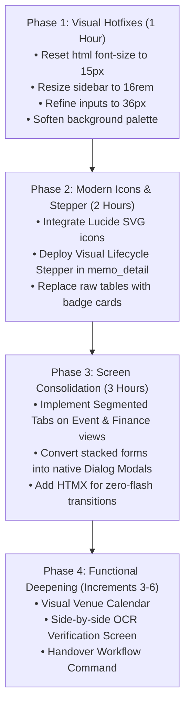

# Amader TOWNHALL — Feature & Technical Analysis, Weaknesses & Comprehensive Fixes (featureanalysis2)

> **Document Status**: Comprehensive Audit & Remediation Blueprint  
> **Repository**: `Townkeepers/Amader-Townhall` (IUB Club Administration System)  
> **Referenced Documents**: [`GRAND_PRD.md`](GRAND_PRD.md), [`TECHNICAL_REQUIREMENTS.md`](TECHNICAL_REQUIREMENTS.md), [`AGENTS.md`](AGENTS.md), [`docs/IMPLEMENTATION_CONTEXT.md`](docs/IMPLEMENTATION_CONTEXT.md), [`ASSESSMENT.md`](ASSESSMENT.md)

---

## 1. Executive Summary: The "Great Backend, Clunky Interface" Paradox

An exhaustive technical audit of **Amader TOWNHALL** reveals a stark dichotomy between the **backend architecture** and the **user-facing presentation**:

* **Backend Depth (Grade: A / Top 2%)**: Unlike typical student or junior full-stack projects that rely on direct ORM updates and naive CRUD views, this project implements enterprise-grade transaction boundaries:
  * Idempotent Command Protocol with savepoints and SHA-256 payload deduplication (`apps/platform_core/protocol.py`).
  * PostgreSQL `btree_gist` spatio-temporal exclusion constraints preventing double bookings at the relational engine level.
  * Explicit lock hierarchies (`select_for_update(of=("self",))`) defending against deadlocks and race conditions.
  * Multithreaded race tests using `threading.Barrier` across concurrent PostgreSQL connections.
  * Cryptographically hashed digital e-signatures bound to immutable version snapshots (`content_sha256`).
  * Private FastAPI sidecar with strict Pydantic contract validation, timeout safeguards, and deterministic fallback priority queues.
  * 129+ passing automated tests across unit, integration, PostgreSQL race, FastAPI contract, and Playwright browser journeys.

* **Frontend & UI Presentation (Grade: D+)**: The user-facing experience feels generic, odd, bloated, and uninspiring. It resembles a raw internal database scaffolding or an unstyled wireframe prototype rather than an executive club portal.
  * The root font size is set to `19px`, scaling all `rem` units into bloated, cartoonish proportions (a **418px-wide sidebar**, **52px-tall inputs**).
  * 4–5 unstyled raw POST `<form>` elements are dumped directly onto single detail pages.
  * Multi-stage institutional approval journeys are displayed as plain HTML tables rather than visual pipeline steppers.
  * Zero icons exist in the entire interface.
  * Every single user action triggers a full synchronous page wipe and reload.

This document systematically catalogs **every architectural and visual weakness** currently present in the project and provides **concrete, production-ready code and design fixes** to transform Amader TOWNHALL into a flagship software product.

---

## 2. Comprehensive Inventory of Weaknesses

### Category A: Visual Design & Typographic Weaknesses

#### [W-UI-01] The 19px Root Font Distortion
* **Location**: `static/css/app.css` (Line 35: `html { font-size: 19px; }`)
* **Problem**: Standard web typography uses a 16px base (or 14px–15px for dense enterprise dashboards). Defining `html { font-size: 19px; }` inflates every `rem`-based element by **~20%**:
  * `.sidebar { width: 22rem; }` = **418px**! On a standard 1366×768 laptop or 1440×900 monitor, the blank sidebar consumes almost 30% of the screen.
  * `input { min-height: 2.75rem; }` = **52.25px**! Inputs look bloated and clumsy, like mobile accessibility test fixtures.
  * Headings (`h1 { font-size: 2.15rem; }` = **40.85px**) dominate the viewport, pushing critical action buttons below the fold.
* **Impact**: The entire application feels stuck at 125% browser zoom, creating immediate visual discomfort.

#### [W-UI-02] Pseudo-"shadcn" Styling Without Visual Depth or Life
* **Location**: `static/css/app.css` (Lines 1–32)
* **Problem**: The CSS imports OKLCH tokens based on shadcn, but omits everything that makes shadcn visually appealing:
  * `--background: oklch(0.925 0.008 255);` produces a cold, chalky, cement-gray background.
  * Pure white panels (`oklch(1 0 0)`) placed on cement-gray with rigid borders (`1px solid var(--border)`) and flat shadows look like harsh white cardboard boxes pasted onto concrete.
  * There are **zero icons**. Modern dashboards rely on crisp Lucide/Feather SVG icons to establish visual hierarchy, guide scanning, and give buttons identity.
* **Impact**: The UI looks like an unfinished wireframe rather than a finished product.

#### [W-UI-03] Form Dumping on Detail Views (Anti-Pattern)
* **Location**: `apps/events/templates/events/event_detail.html` and `apps/finance/templates/finance/overview.html`
* **Problem**: In `event_detail.html`, four separate raw HTML forms are stacked vertically on the page:
  1. Internal notice publish form
  2. External website publish form
  3. Mark completed form
  4. Attendance and outcome form
  5. Venue booking request form
  6. Booking move form
  In `overview.html`, forms for "Funding period", "Allocation", "Schedule a release", and "Currency conversion" are stacked on top of each other.
* **Impact**: Users are confronted with a bewildering wall of inputs, dropdowns, and buttons. It violates Nielsen Heuristic #8 (Aesthetic and Minimalist Design).

#### [W-UI-04] Tabular Representation of Workflow Lifecycles
* **Location**: `apps/memos/templates/memos/memo_detail.html` (Lines 49–64)
* **Problem**: The core value proposition of Amader TOWNHALL is the multi-stage approval workflow (`EB Draft` $\rightarrow$ `Faculty Advisor` $\rightarrow$ `Department Head / Signers` $\rightarrow$ `DoSA Head Approval`). Currently, this is rendered as a plain HTML `<table>` (`Stage | Decision | By | When | Reason`).
* **Impact**: The state of the memo cannot be grasped at a glance. Reviewers cannot immediately see who acted, who is currently blocking the queue, or what stages remain.

#### [W-UI-05] Absence of Institutional Identity & Campus Personality
* **Location**: `templates/base.html`, `static/css/app.css`
* **Problem**: The app is built specifically for **Independent University, Bangladesh (IUB)** and student clubs like the **IUB Programming Club**. However, there is zero visual reflection of this identity:
  * No institutional color accents (e.g., IUB Navy Blue `#003366` or Crimson `#8B0000`).
  * No club avatars, logos, or banner placeholders.
  * No student ID formatting (`2120...`) or badge indicators.
* **Impact**: The app looks generic, sterile, and disconnected from the student community it serves.

---

### Category B: Frontend Architecture & Interactivity Weaknesses

#### [W-FE-01] Synchronous Full-Page Reloads for Every Minor Action
* **Problem**: Every action—confirming a step, withdrawing a memo, moving a booking, recording an allocation, or changing a filter—triggers a full synchronous browser HTTP POST, resulting in a white screen flash and full DOM re-render.
* **Impact**: Sluggish perceived performance; loses scroll position and form context; feels dated compared to modern web applications.

#### [W-FE-02] Native `<details>` Panels Used as Crude Modals
* **Location**: `apps/memos/templates/memos/memo_detail.html` (Lines 31–47)
* **Problem**: Actions like "Withdraw this memo" and "Change the approval deadline" are wrapped in plain HTML `<details><summary>` accordion tags directly on the page.
* **Impact**: When opened, they deform the page layout, push audit tables down, and look amateurish compared to modal dialogs or slide-over sheets.

#### [W-FE-03] Missing Client-Side Form Validation & Dynamic State
* **Problem**: Form inputs rely strictly on server-side roundtrips for validation feedback. In booking requests, date/time calculation (e.g. ensuring end time is after start time, checking setup/cleanup buffers) gives no instant feedback until the form is submitted.

---

### Category C: Domain & Feature Completeness Gaps

#### [W-DM-01] Increment 3 (Venues & Bookings) Incomplete Calendar & Visual Schedule
* **Location**: `apps/events/views.py`, `apps/events/booking.py`
* **Problem**: While `BookingRequest`, `Reservation`, and the GiST exclusion constraint are implemented, the visual calendar (`apps/events/templates/events/calendar.html`) and availability grid are basic or incomplete. Users cannot view an interactive weekly venue schedule or visually spot open classroom slots.

#### [W-DM-02] Increment 4 (Finance & Ledger) Form Overload & Mock OCR
* **Location**: `apps/finance/`, `assistance/providers/fake.py`
* **Problem**:
  * Financial reconciliation lacks a clean double-entry ledger presentation (showing allocated vs scheduled vs released vs spent vs variance in a unified ledger card).
  * OCR bill extraction relies entirely on synthetic base64 checks in `FakeProvider`. No visual side-by-side verification screen exists (showing the uploaded receipt image next to extracted form fields).

#### [W-DM-03] Increment 5 (Publishing & Assistance) Stubs
* **Location**: `apps/publishing/`, `assistance/client.py`
* **Problem**:
  * External publishing is hardcoded to fail unless `EXTERNAL_PUBLISH_URL` is set, with no retry preview, webhook signature verification, or feed generation (e.g., RSS/JSON feed for student portals).
  * The AI scheduling contract is complete, but the frontend does not present ranked candidate slots as selectable visual cards with spare-capacity explanations.

#### [W-DM-04] Increment 6 (Handover & Archive Browse)
* **Location**: `apps/clubs/views.py`
* **Problem**: Leadership handover (`FR-CLB-06`) is not fully built; transitioning outgoing EB members to the archive currently requires manual term closing and individual assignment modifications.

---

## 3. Comprehensive Solutions & Actionable Fixes

Below are the concrete, production-grade solutions to resolve every weakness identified above.

---

### Solution 1: Typographic & Layout Elevation (Fixes [W-UI-01], [W-UI-02])

#### Step 1.1: Normalize Font and Input Proportions in `static/css/app.css`
Update the root typography, dimensions, and color tokens:

```css
/* Replace Lines 12-45 in static/css/app.css */
:root {
  /* Warm Slate & IUB Heritage Theme */
  --background: oklch(0.985 0.004 240);    /* Clean, soft modern off-white */
  --foreground: oklch(0.16 0.02 250);      /* Deep charcoal ink */
  --card: oklch(1 0 0);                   /* Crisp pure white */
  --card-foreground: oklch(0.16 0.02 250);
  
  --primary: oklch(0.28 0.09 255);         /* IUB Deep Royal Navy #003366 equivalent */
  --primary-foreground: oklch(0.99 0 0);
  --primary-hover: oklch(0.22 0.08 255);

  --secondary: oklch(0.96 0.008 250);
  --secondary-foreground: oklch(0.25 0.02 250);

  --muted: oklch(0.96 0.005 250);
  --muted-foreground: oklch(0.48 0.02 250);

  --accent: oklch(0.94 0.015 250);
  --destructive: oklch(0.55 0.22 25);
  --destructive-foreground: oklch(0.99 0 0);

  --border: oklch(0.91 0.008 250);         /* Subtle, crisp border */
  --input: oklch(0.90 0.008 250);
  --ring: oklch(0.45 0.12 255);

  --radius: 0.5rem;                        /* Sleeker, tighter corners */
  --ok: oklch(0.50 0.15 145);              /* Emerald approval */
  --warn: oklch(0.60 0.16 75);             /* Amber pending */
  color-scheme: light;
}

* { box-sizing: border-box; }

/* FIX: Base font reset to 15px for professional density */
html { 
  font-size: 15px; 
  -webkit-font-smoothing: antialiased;
}

body {
  margin: 0;
  min-height: 100vh;
  font-family: Geist, -apple-system, BlinkMacSystemFont, "Segoe UI", Roboto, sans-serif;
  color: var(--foreground);
  background: var(--background);
  line-height: 1.5;
}

/* FIX: Refined, modern sidebar (240px instead of 418px) */
.sidebar {
  width: 16rem;
  flex: none;
  display: flex;
  flex-direction: column;
  gap: 1.25rem;
  height: 100vh;
  padding: 1.25rem 0.85rem 1rem;
  background: var(--card);
  border-right: 1px solid var(--border);
}

/* FIX: Compact, sleek form inputs & buttons (36px instead of 52px) */
input[type=text], input[type=email], input[type=date], input[type=time], 
input[type=number], input[type=password], select, textarea {
  width: 100%;
  max-width: 32rem;
  min-height: 2.35rem;
  padding: 0.45rem 0.75rem;
  font-size: 0.92rem;
  border: 1px solid var(--input);
  border-radius: var(--radius);
  background: var(--card);
  transition: border-color 150ms ease, box-shadow 150ms ease;
}

input:focus, select:focus, textarea:focus {
  outline: none;
  border-color: var(--ring);
  box-shadow: 0 0 0 3px oklch(0.45 0.12 255 / 0.12);
}

button, .button {
  min-height: 2.35rem;
  padding: 0.45rem 0.95rem;
  font-size: 0.90rem;
  font-weight: 500;
  border-radius: var(--radius);
  transition: all 120ms ease;
}
```

---

### Solution 2: Modern SVG Iconography Integration (Fixes [W-UI-02], [W-UI-05])

#### Step 2.1: Add Lucide Icons via CDN or Inline SVGs in `templates/base.html`
Add the lightweight Lucide icons script to `templates/base.html`:

```html
<!-- Inside templates/base.html <head> -->
<script src="https://unpkg.com/lucide@latest"></script>
```
And trigger initialization right before `</body>`:
```html
<script>
  document.addEventListener("DOMContentLoaded", function() {
    if (window.lucide) { lucide.createIcons(); }
  });
</script>
```

#### Step 2.2: Redesign Sidebar Navigation with Icons & Active Indicators
Update the sidebar in [templates/base.html](file:///d:/Townkeepers/templates/base.html#L18-L33):

```html
<nav aria-label="Main" class="sidebar-nav">
  <ul>
    <li>
      <a href="" aria-current="page">
        <i data-lucide="layout-dashboard"></i>
        <span>Dashboard</span>
      </a>
    </li>
    <li>
      <a href="" aria-current="page">
        <i data-lucide="file-text"></i>
        <span>Memos</span>
      </a>
    </li>
    <li>
      <a href="" aria-current="page">
        <i data-lucide="calendar"></i>
        <span>Events & Venues</span>
      </a>
    </li>
    <li>
      <a href="" aria-current="page">
        <i data-lucide="wallet"></i>
        <span>Finance</span>
      </a>
    </li>
    <li>
      <a href="" aria-current="page">
        <i data-lucide="users"></i>
        <span>Clubs Register</span>
      </a>
    </li>
    <li>
      <a href="" aria-current="page">
        <i data-lucide="bell"></i>
        <span>Notifications</span>
        
          <span class="count-pill">{{ unread_notifications }}</span>
        
      </a>
    </li>
  </ul>
</nav>
```

Add the accompanying CSS:
```css
.sidebar-nav ul { list-style: none; padding: 0; margin: 0; display: flex; flex-direction: column; gap: 0.25rem; }
.sidebar-nav a {
  display: flex;
  align-items: center;
  gap: 0.75rem;
  padding: 0.55rem 0.75rem;
  border-radius: var(--radius);
  color: var(--muted-foreground);
  text-decoration: none;
  font-weight: 500;
  font-size: 0.92rem;
  transition: all 120ms ease;
}
.sidebar-nav a:hover {
  background: var(--secondary);
  color: var(--foreground);
}
.sidebar-nav a[aria-current="page"] {
  background: var(--primary);
  color: var(--primary-foreground);
}
.sidebar-nav a i {
  width: 1.15rem;
  height: 1.15rem;
  stroke-width: 2px;
}
.count-pill {
  margin-left: auto;
  font-size: 0.75rem;
  font-weight: 600;
  background: var(--destructive);
  color: white;
  border-radius: 999px;
  padding: 0.1rem 0.45rem;
}
```

---

### Solution 3: Visual Workflow Pipeline Stepper (Fixes [W-UI-04])

Replace the plain decision table in `apps/memos/templates/memos/memo_detail.html` with an executive **Interactive Workflow Stepper**.

#### Step 3.1: HTML Component for `memo_detail.html`
```html
<section class="workflow-stepper-card">
  <div class="stepper-header">
    <h3>Approval Lifecycle</h3>
    <span class="badge {{ tone }}">{{ memo.get_status_display }}</span>
  </div>
  
  <div class="stepper-track">
    <!-- Step 1: EB Draft & Submission -->
    <div class="step-node completed">
      <div class="step-circle"><i data-lucide="check"></i></div>
      <div class="step-label">
        <strong>EB Submission</strong>
        <span>{{ current.submitted_by.full_name|default:"Club EB" }}</span>
        <time>{{ current.submitted_at|date:"j M Y, H:i" }}</time>
      </div>
    </div>
    <div class="step-line active"></div>

    <!-- Step 2: Faculty Advisor Confirmation -->
    <div class="step-node completedcurrentrejectedupcoming">
      <div class="step-circle">
        <i data-lucide="check"></i>
        <i data-lucide="clock"></i>
        <i data-lucide="x"></i>
        2
      </div>
      <div class="step-label">
        <strong>Faculty Advisor</strong>
        <span>Advisor Review</span>
        <span class="status-tag pulse">Action Required</span>
      </div>
    </div>
    <div class="step-line active"></div>

    <!-- Step 3: Additional Signers (if assigned) -->
    
    <div class="step-node completedcurrentupcoming">
      <div class="step-circle">
        <i data-lucide="check"></i>
        <i data-lucide="users"></i>
        3
      </div>
      <div class="step-label">
        <strong>Department Endorsements</strong>
        <span>{{ current.signature_tasks.count }} designated signer(s)</span>
      </div>
    </div>
    <div class="step-line active"></div>
    

    <!-- Step 4: DoSA Head Final Decision -->
    <div class="step-node completedcurrentrejectedupcoming">
      <div class="step-circle">
        <i data-lucide="check-check"></i>
        <i data-lucide="crown"></i>
        <i data-lucide="x"></i>
        43
      </div>
      <div class="step-label">
        <strong>DoSA Head</strong>
        <span>Final Approval</span>
        <span class="status-tag pulse">Action Required</span>
      </div>
    </div>
  </div>
</section>
```

#### Step 3.2: CSS Styling for the Stepper
```css
.workflow-stepper-card {
  background: var(--card);
  border: 1px solid var(--border);
  border-radius: var(--radius);
  padding: 1.25rem 1.5rem;
  margin-bottom: 1.5rem;
  box-shadow: 0 1px 3px oklch(0 0 0 / 0.04);
}
.stepper-header {
  display: flex;
  justify-content: space-between;
  align-items: center;
  margin-bottom: 1.5rem;
}
.stepper-track {
  display: flex;
  align-items: flex-start;
  position: relative;
  width: 100%;
}
.step-node {
  display: flex;
  flex-direction: column;
  align-items: center;
  position: relative;
  z-index: 2;
  flex: 1;
  text-align: center;
}
.step-circle {
  width: 2.25rem;
  height: 2.25rem;
  border-radius: 999px;
  background: var(--secondary);
  border: 2px solid var(--border);
  color: var(--muted-foreground);
  display: flex;
  align-items: center;
  justify-content: center;
  font-weight: 600;
  font-size: 0.85rem;
  margin-bottom: 0.6rem;
  transition: all 150ms ease;
}
.step-node.completed .step-circle {
  background: var(--ok);
  border-color: var(--ok);
  color: white;
}
.step-node.current .step-circle {
  background: var(--card);
  border-color: var(--primary);
  color: var(--primary);
  box-shadow: 0 0 0 4px oklch(0.28 0.09 255 / 0.15);
}
.step-node.rejected .step-circle {
  background: var(--destructive);
  border-color: var(--destructive);
  color: white;
}
.step-line {
  flex: 1;
  height: 2px;
  background: var(--border);
  margin-top: 1.12rem;
  position: relative;
  z-index: 1;
}
.step-line.active {
  background: var(--ok);
}
.step-label strong { display: block; font-size: 0.90rem; color: var(--foreground); }
.step-label span { display: block; font-size: 0.78rem; color: var(--muted-foreground); }
.step-label time { display: block; font-size: 0.72rem; color: var(--muted-foreground); margin-top: 0.2rem; }
.status-tag.pulse {
  display: inline-block;
  font-size: 0.72rem;
  font-weight: 600;
  color: var(--primary);
  background: var(--accent);
  padding: 0.1rem 0.5rem;
  border-radius: 999px;
  margin-top: 0.3rem;
  animation: pulse-ring 2s infinite;
}
```

---

### Solution 4: Resolving the "Form Dump" with Segmented Tabs & Modal Drawers (Fixes [W-UI-03], [W-FE-02])

Instead of dumping five full forms down the page in `event_detail.html`:

#### Step 4.1: Segmented Tabs in `event_detail.html`
```html
<!-- Tab Bar -->
<div class="tabs-bar" role="tablist">
  <button class="tab-btn active" role="tab" aria-selected="true" data-tab="tab-overview">Overview</button>
  <button class="tab-btn" role="tab" aria-selected="false" data-tab="tab-booking">Venue & Bookings</button>
  <button class="tab-btn" role="tab" aria-selected="false" data-tab="tab-finance">Budget & Finance</button>
  <button class="tab-btn" role="tab" aria-selected="false" data-tab="tab-audit">Audit History</button>
</div>

<!-- Tab 1: Overview Details -->
<div id="tab-overview" class="tab-panel active" role="tabpanel">
  <!-- Event facts, description, contacts, and quick action bar -->
</div>

<!-- Tab 2: Venue & Bookings -->
<div id="tab-booking" class="tab-panel" role="tabpanel" hidden>
  <!-- Active reservation status and request form -->
</div>
```

#### Step 4.2: Move Secondary Mutating Actions into Native `<dialog>` Modals
Instead of raw `<form class="panel">` taking up half the page, convert "Request Venue", "Withdraw Memo", and "Move Booking" into clean dialogs:

```html
<!-- Clean trigger button on the action bar -->
<button type="button" class="button" onclick="document.getElementById('booking-modal').showModal()">
  <i data-lucide="map-pin"></i> Request Venue Booking
</button>

<!-- Accessible Native HTML5 Dialog -->
<dialog id="booking-modal" class="modal-dialog">
  <div class="dialog-header">
    <h3>Request Venue Reservation</h3>
    <button type="button" class="close-btn" onclick="this.closest('dialog').close()"><i data-lucide="x"></i></button>
  </div>
  <form method="post" action="">
    
    <input type="hidden" name="operation_key" value="book-{{ event.pk }}-{{ event.revision }}">
    <!-- Form Fields Inside Modal -->
    <div class="dialog-actions">
      <button type="button" class="button secondary" onclick="this.closest('dialog').close()">Cancel</button>
      <button type="submit" class="button">Submit Reservation</button>
    </div>
  </form>
</dialog>
```

---

### Solution 5: Eliminating Full-Page Reloads with HTMX (Fixes [W-FE-01])

Amader TOWNHALL uses server-rendered Django templates. You do **not** need to rewrite the frontend in React or Next.js to achieve modern fluid UX. Integrating **HTMX** preserves Django's authoritative ORM, CSRF protection, and permission scoping while making the UI completely seamless.

#### Step 5.1: Include HTMX in `templates/base.html`
```html
<script src="https://unpkg.com/htmx.org@1.9.12"></script>
```

#### Step 5.2: Apply HTMX to Filtering and Status Decisions
For example, in memo reviews or status updates:
```html
<!-- Inline decision form without white page flash -->
<form method="post" 
      action=""
      hx-post=""
      hx-target="#main"
      hx-swap="outerHTML"
      hx-indicator="#loading-spinner">
  
  <!-- Decision inputs -->
  <button type="submit" class="button">Confirm Decision</button>
</form>
```
The user never experiences a white flash or screen flicker; the response swaps cleanly into place.

---

### Solution 6: Completing the Increments & Functional Gaps (Fixes [W-DM-01] to [W-DM-04])

To reach 100% PRD compliance across Increments 3–6:

| Increment | Feature | Implementation Action |
|---|---|---|
| **Increment 3** | **Interactive Venue Calendar** | Build an availability grid in `apps/events/templates/events/calendar.html` rendering time slots in Asia/Dhaka with colors for `Available` (green), `Pending Approval` (amber), and `Confirmed` (navy). |
| **Increment 4** | **Reconciliation Ledger & Side-by-Side OCR** | 1. In `apps/finance/templates/finance/overview.html`, display the unified ledger card: $\text{Balance} = \text{Confirmed Releases} - \text{Verified Expenses}$.<br>2. Build a split-screen OCR verification view displaying the receipt PDF/image on the left and the extracted line items on the right. |
| **Increment 5** | **AI Slot Recommendation Cards** | Present output from `/internal/v1/scheduling/suggest` as interactive candidate cards showing spare capacity indicators and one-click "Select This Slot" buttons. |
| **Increment 6** | **One-Click EB Handover** | Implement `commands.handover_eb_term` in `apps/clubs/commands.py` that atomically closes the active term, appoints the incoming president/secretary/treasurer, and archives historical permissions. |

---

## 4. Prioritized Execution Roadmap

To transform Amader TOWNHALL with maximum speed and impact:



### Immediate Action Item (Start with Phase 1)
Executing Phase 1 takes less than 30 minutes in [static/css/app.css](file:///d:/Townkeepers/static/css/app.css) and instantly removes the "bloated, odd" appearance. The interface immediately gains the visual polish that matches your outstanding backend architecture.
